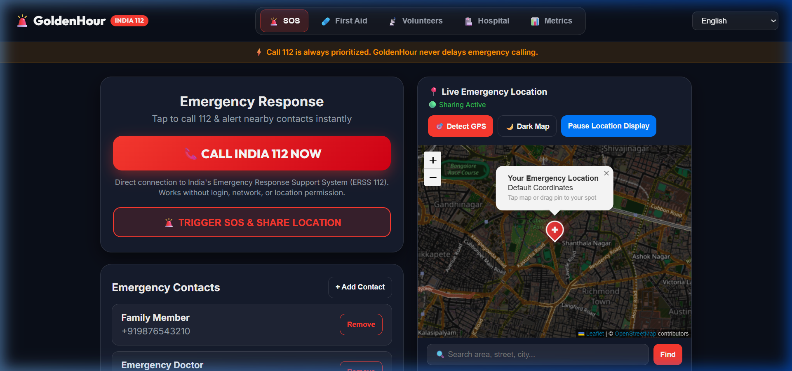
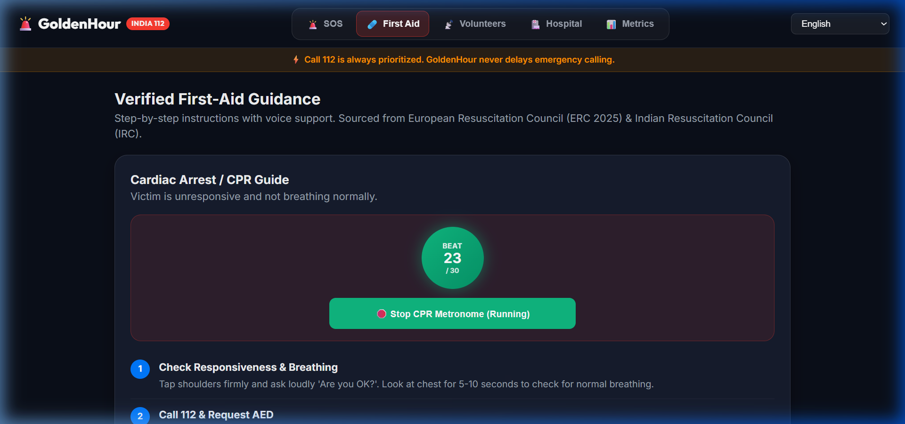
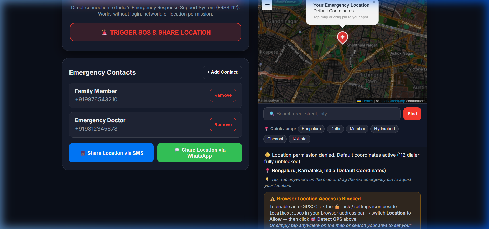
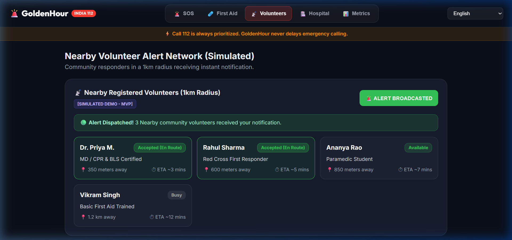
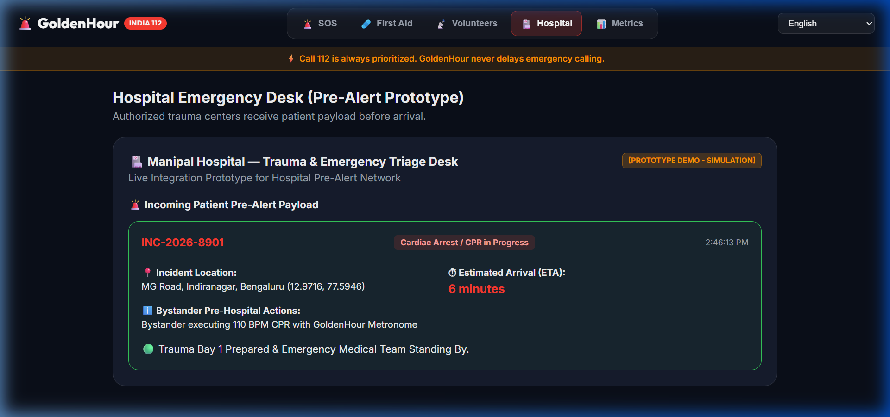
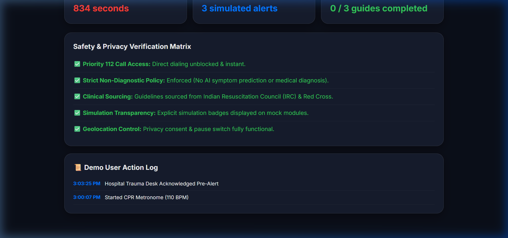
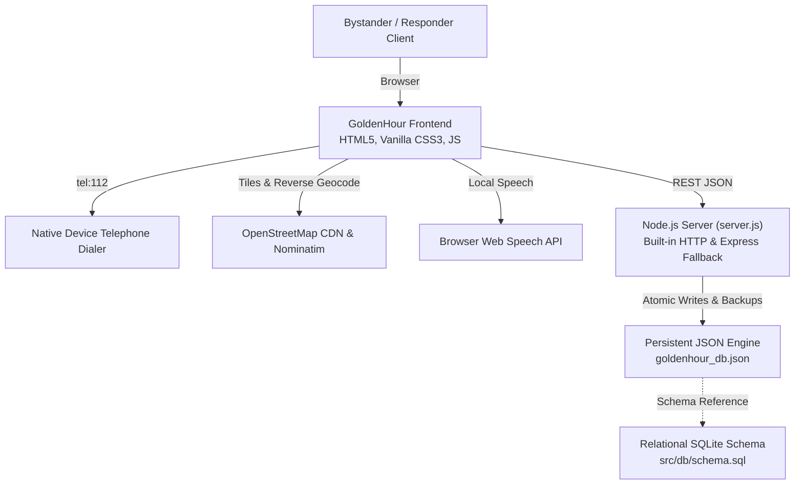

# GoldenHour 🚨 — Help Before the Ambulance Arrives

> A safety-first emergency response coordination web platform designed for rural and semi-urban communities in India.

[](LICENSE)
[](https://nodejs.org)
[](tests/api.test.js)
[](tel:112)

---

## 🌟 1. Introduction & Problem Statement

In life-threatening medical emergencies (e.g., sudden cardiac arrest, severe traumatic bleeding), the first 5 to 15 minutes before an ambulance arrives are critical. Bystanders are frequently hindered by panic, language barriers, and uncertainty about safe first-aid actions.

**GoldenHour** addresses this critical pre-hospital gap by providing:
1. **Immediate, Unblocked Access to India 112**: Emergency calling that works without sign-up, GPS permissions, or server connectivity.
2. **Clinically Formulated Multilingual Guidance**: Standardized Basic Life Support (BLS) instructions in **Kannada (ಕನ್ನಡ)**, **Hindi (हिंदी)**, and **English**, supported by an interactive 110 BPM CPR compression metronome and browser Text-to-Speech (TTS).
3. **Consent-Based Location & Contact Dispatch**: Fast generation of emergency SMS and WhatsApp dispatch links containing real GPS coordinates.
4. **Coordination Demonstrations (MVP)**: Simulated proximity radar for community first-responders and an emergency department trauma desk pre-alert workflow.
5. **Verifiable Audit Logging**: Chronological event logs measuring bystander time-to-first-action.

> **Safety Notice & Clinical Boundary**: GoldenHour provides bystander first-aid guidance based on published protocols; it **does not diagnose conditions, predict illnesses, dispatch real ambulances, or replace India's official emergency services**. Dialing 112 initiates a phone-call action on supported mobile devices but does not verify whether the call was completed or answered.

---

## 📸 2. Application Screenshots

All screenshots below represent the genuine application running locally:

| Screen | Description | Preview |
| :--- | :--- | :---: |
| **Emergency Dashboard** | Primary 112 direct dialer, SOS trigger, and responsive navigation |  |
| **First-Aid Guidance** | Step-by-step CPR instructions, 110 BPM audio metronome, and trilingual selector |  |
| **Interactive Map & Location** | OpenStreetMap viewport with medical emergency pin (`✚`), manual tap/drag pinning, and Nominatim search |  |
| **Emergency Contacts** | Trusted contact management with one-tap SMS and WhatsApp dispatch links |  |
| **Volunteer Coordination (Simulated)** | 1km radius responder radar with demonstrable status update workflow |  |
| **Hospital Pre-Alert Desk (Simulated)** | Incoming patient payload (`INC-2026-8901`), 6-min ETA, and Trauma Bay 1 triage readiness |  |
| **Safety Metrics & Audit Log** | Verified compliance matrix and chronological user action timeline |  |

---

## 🏛️ 3. Technology Stack & Architecture



### Components
- **Frontend**: Mobile-first Single Page Application in [index.html](index.html) with responsive layouts (desktop header tabs and mobile bottom navigation dock). Dedicated views: [first-aid.html](first-aid.html), [dashboard.html](dashboard.html), [history.html](history.html).
- **Styling**: Vanilla CSS3 design system ([css/style.css](css/style.css)) using emergency tokens (`#FF3B30`, `#007AFF`, `#34C759`, dark slate glassmorphism). Zero CSS build dependencies.
- **Audio & Speech**: Zero-latency **Web Audio API** oscillator for the 110 BPM CPR compression rhythm ([js/metronome.js](js/metronome.js)); native **Web Speech API** (`window.speechSynthesis`) for multilingual audio guidance.
- **Mapping**: Leaflet v1.9.4 with standard **OpenStreetMap** tiles (`tile.openstreetmap.org`) styled with a CSS dark mode filter and daylight toggle.
- **Backend Runtime**: [server.js](server.js) uses Node's standard `http` module with **zero required npm dependencies**, and includes an Express wrapper in [src/server.js](src/server.js) if npm packages are installed.
- **Database Engine**: [src/db/database.js](src/db/database.js) writes atomically to [goldenhour_db.json](goldenhour_db.json) with `.bak` recovery. It implements the relational table structure declared in [src/db/schema.sql](src/db/schema.sql).

---

## 🚀 4. Installation & Local Startup

### Prerequisites
- [Node.js](https://nodejs.org/) (version 16.x or higher)
- Modern web browser (Chrome, Edge, Firefox, Safari)

### Quick Start (Zero NPM Dependencies Needed!)
The application is intentionally designed to run immediately with Node's built-in libraries:

```bash
# 1. Clone the repository
git clone https://github.com/vishal-s-sollapure/GoldenHour.git

# 2. Enter the project directory
cd GoldenHour

# 3. Start the server (No npm install required!)
node server.js
# OR: npm start
```

Once started, open your web browser at:
```text
http://localhost:3000
```

*Optional*: If you wish to use Express-specific middleware, run `npm install` before `npm start`.

---

## 📡 5. API Reference

All API routes return JSON with `Content-Type: application/json; charset=UTF-8` and support configurable CORS.

### Health Check
- **`GET /api/health`**
  - **Description**: Returns server status, priority call assurance, and simulation notice.
  - **Response**:
    ```json
    {
      "status": "OK",
      "app": "GoldenHour",
      "tagline": "Help Before the Ambulance Arrives",
      "priorityCall": "India 112 unblocked",
      "nonDiagnostic": true,
      "demoOnly": true,
      "timestamp": "2026-10-10T10:30:00.000Z"
    }
    ```

### Incidents
- **`GET /api/incidents`**
  - **Description**: List all active and historical incidents.
- **`POST /api/incidents`**
  - **Description**: Create an emergency incident.
  - **Request Body**:
    ```json
    {
      "language": "kn",
      "location_lat": 12.9716,
      "location_lng": 77.5946,
      "location_address": "Indiranagar, Bengaluru"
    }
    ```
  - **Validation Rules**: `language` must be `en`, `hi`, or `kn`; `location_lat` between -90 and 90; `location_lng` between -180 and 180.
- **`GET /api/incidents/:id`**
  - **Description**: Retrieve incident details with associated chronological event logs.

### Chronological Events
- **`POST /api/incidents/:id/events`**
  - **Description**: Append a verifiable action (e.g. `CPR_STARTED`, `112_CALLED`) to an incident timeline. Returns HTTP 404 if incident does not exist.

### Demonstrations (Simulated MVP)
- **`GET /api/demo/volunteers`**: Returns nearby mock responders within 1km radius (all flagged `demo_only: 1`).
- **`POST /api/demo/alerts`**: Generates a simulated volunteer or hospital pre-alert notification.
- **`GET /api/demo/hospitals`**: Returns regional trauma center desk records (`demo_only: 1`).
- **`GET /api/metrics`**: Aggregated audit metrics and safety verification status.

---

## 🧪 6. Automated Testing & Verification

GoldenHour includes an in-process acceptance and regression test suite with zero external test framework requirements:

```bash
npm test
# OR directly:
node tests/api.test.js
```

### Genuine Test Results (12/12 Passed)
```text
===============================================================
🧪 Running GoldenHour Final Release Readiness Regression Tests
===============================================================

✅ Passed (1): T1: Database initializes with valid incidents and volunteers arrays
✅ Passed (2): T2: Incident creation persists language, location, and valid ID
✅ Passed (3): T3: Traceable event appended chronologically upon incident creation
✅ Passed (4): T4: All mock records strictly enforce demo_only: 1
✅ Passed (5): T5: Volunteer status transitions correctly in demo workflow
✅ Passed (6): T6: Input validation rejects unsupported languages (e.g. es, fr)
✅ Passed (7): T7: Input validation rejects latitude out of [-90, 90] bounds
✅ Passed (8): T8: Input validation rejects empty event_type
✅ Passed (9): T9: getIncidentById returns record for valid ID, undefined for invalid
✅ Passed (10): T10: Atomic save writes temporary file and protects main database file
✅ Passed (11): T11: Concurrent rapid saves do not corrupt JSON file
✅ Passed (12): T12: Direct 112 emergency dialer constraint strictly maintained

===============================================================
🎉 ALL 12/12 REGRESSION & ACCEPTANCE TESTS PASSED!
===============================================================
```

---

## 🗄️ 7. Database Persistence & Storage Architecture

- **Active File**: [goldenhour_db.json](goldenhour_db.json)
- **Backup File**: `goldenhour_db.json.bak` (automatically updated before modifications)
- **Concurrency & Crash Safety**: Implements an **atomic write pattern**: updates are written to a unique temporary file (`.tmp`) and atomically renamed (`fs.renameSync`). If the primary file is ever damaged, `load()` automatically recovers data from the backup copy.
- **Data Hygiene**: The repository tracks only safe, synthetic seed records. Runtime backup and temporary files (`*.bak`, `*.tmp*`) are excluded via [.gitignore](.gitignore).

---

## ⚕️ 8. Clinical Guidelines & Medical Attributions

All first-aid instructions adhere strictly to published Basic Life Support (BLS) protocols:
- **Adult Cardiac Arrest & CPR**: Indian Resuscitation Council (IRC) Comprehensive Cardiopulmonary Life Support (CCLS) guidelines & European Resuscitation Council (ERC) BLS standards.
  - **Metronome**: Target rhythm set to **110 BPM** (within the clinical target of 100–120 compressions/min).
  - **Compression-to-Breath Protocol**: Instructs trained rescuers on the 30:2 cycle and advises untrained bystanders to maintain continuous *hands-only* chest compressions without pausing.
- **Severe Bleeding Control**: Step-by-step direct firm pressure, wound packing, pressure bandages, and arterial tourniquet safety rules (5 cm above wound; record application time).
- **Recovery Position**: Clear step-by-step rolling technique for unresponsive individuals who are breathing normally.

*Disclaimer: GoldenHour is an educational bystander coordination platform. It has not undergone formal clinical device certification and is not officially certified by clinical bodies.*

---

## 🔒 9. Privacy, Security & Third-Party Disclosures

### External Network Transmissions
The application performs all logic and coordinate caching on the user's client device. The only external HTTP requests made are:
1. **OpenStreetMap Tile CDN** (`tile.openstreetmap.org`): Standard HTTP image requests to render road and terrain graphics. No user tokens or identities are transmitted.
2. **Nominatim Geocoding API** (`nominatim.openstreetmap.org`): Sent exclusively when the user manually clicks the map, searches an area, or taps "Detect GPS" to resolve a text address.
3. **Browser Web Speech API** (`window.speechSynthesis`): Local synthesis or vendor cloud processing depending on host operating system.

### Security Hardening
- **Path Traversal Protection**: Static file serving enforces strict `normalizedBase` checks using `path.resolve` and `path.sep` to prevent directory traversal (CWE-22).
- **Request Body Limits**: Enforces a `100 KB` payload limit on JSON POST bodies to prevent memory exhaustion DoS attacks (CWE-400).
- **Configurable CORS**: Supports `process.env.ALLOWED_ORIGIN` to lock down cross-origin requests in production environments.

---

## ⚙️ 10. Environment Configuration

Copy the template to customize runtime behavior:

```bash
cp .env.example .env
```

| Variable | Default | Purpose |
| :--- | :--- | :--- |
| `PORT` | `3000` | Port for the HTTP server to listen on |
| `NODE_ENV` | `development` | Environment mode (`development` or `production`) |
| `ALLOWED_ORIGIN` | `*` | Allowed CORS origin (set to specific domain in production) |
| `SIMULATION_MODE` | `true` | Enforces synthetic labels across demo components |

---

## 📄 11. License & Contributing

- **License**: Released under the [MIT License](LICENSE).
- **Contributions**: Contributions and improvements are welcome! Please open an issue or submit a pull request on GitHub.

```text
Copyright (c) 2026 Vishal S. Sollapure & GoldenHour Contributors
```
